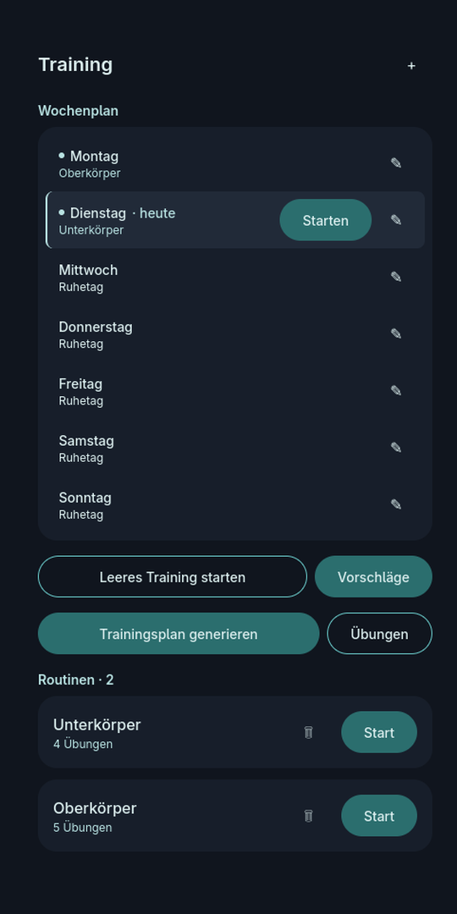
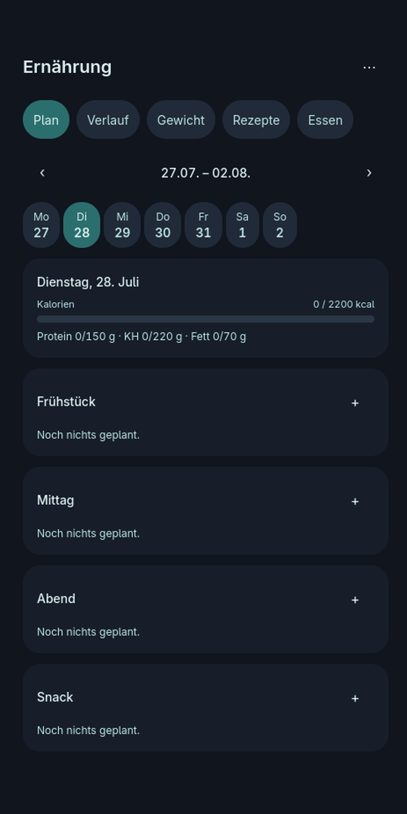
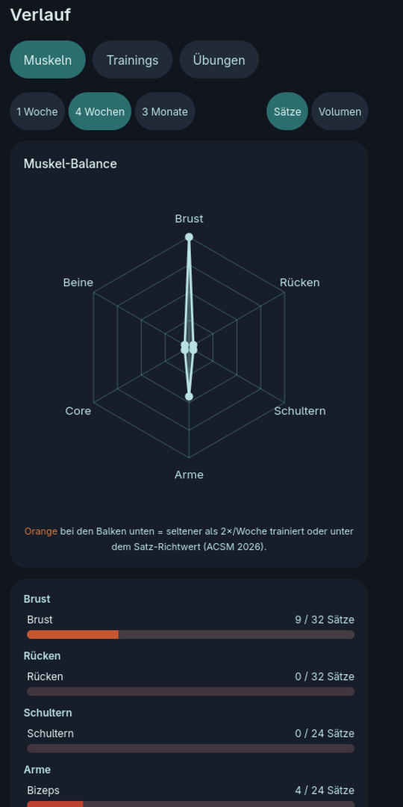
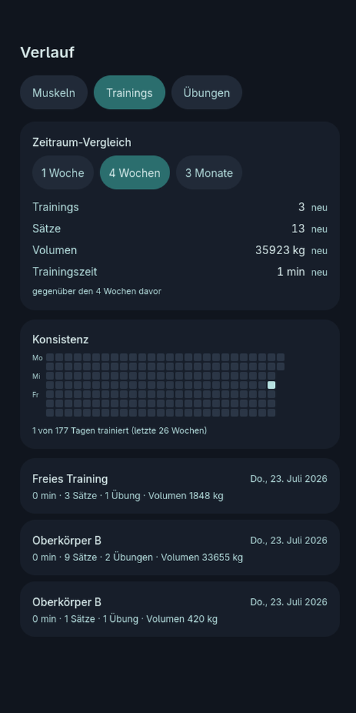
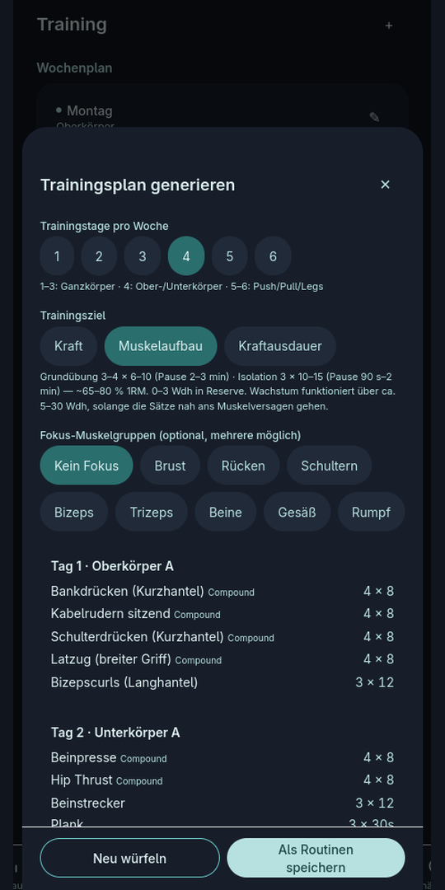
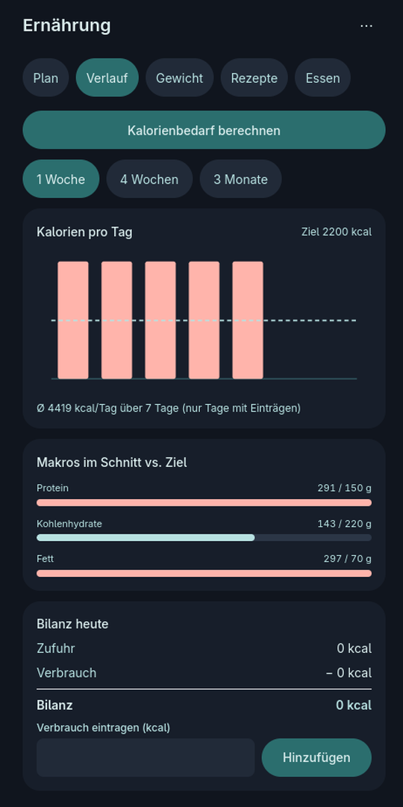
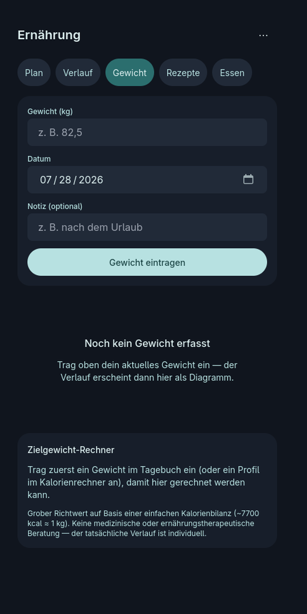
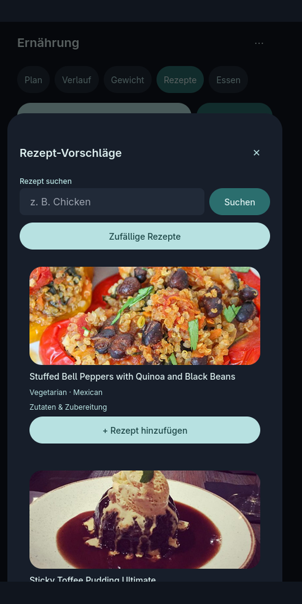
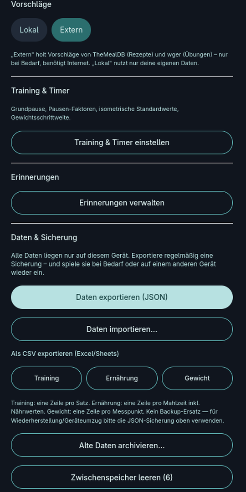

# Gym App

Persönliche All-in-One Fitness-App für **Training, Verlauf und Ernährung** – entwickelt als schnelle, offline-fähige Progressive Web App (PWA). Alle persönlichen Trainings- und Ernährungsdaten werden lokal auf dem eigenen Gerät gespeichert, ohne Cloud-Zwang und ohne Tracking.

---

## Überblick & Features

- **Training & Wochenplan:** Routinen verwalten, Sätze, Gewichte und RIR erfassen, integrierter Pausentimer mit Benachrichtigungen sowie intelligenter Trainingsplan-Generator nach Fokus und Zielen.
- **Verlauf & Muskel-Balance:** Auswertung des Trainingsvolumens, Muskel-Balance als Netzdiagramm mit wissenschaftlichen Satz-Korridoren und Zeitraum-Vergleich.
- **Ernährung & Kalorientracker:** Tagesplan mit Kalorien- und Makro-Übersicht, Barcode-/Lebensmittelsuche (über Open Food Facts), Vorratskammer, Einkaufsliste und Rezept-Vorschläge.
- **Gewichtstagebuch:** Gewichtsverlauf mit geglätteter Trendkurve und Zielrechner.
- **100 % Lokal & Offline-fähig:** Komplett lokale Datenhaltung im Browser inkl. Backup-Export und -Import.

---

## Screenshots

| Training | Ernährung | Muskel-Balance |
| :---: | :---: | :---: |
|  |  |  |

| Trainingsverlauf | Plan-Generator | Ernährungsverlauf |
| :---: | :---: | :---: |
|  |  |  |

| Gewicht | Rezepte | Einstellungen |
| :---: | :---: | :---: |
|  |  |  |

---

## Lokale Ausführung

### Voraussetzungen
- [Node.js](https://nodejs.org/) (Version 18 oder neuer)

### Installation & Start

```bash
# Abhängigkeiten installieren
npm install

# Lokalen Entwicklungsserver starten (Port 3000)
npm run dev

# Produktions-Build erstellen
npm run build
```

---

## Lizenz & Rechtliches

© 2026 Julian – Alle Rechte vorbehalten.

Private, nicht-kommerzielle Nutzung ist erlaubt. Kein Re-Publish, kein Verkauf und keine kommerzielle Verwertung ohne Genehmigung des Urhebers. Weitere Details siehe [LICENSE](./LICENSE).
